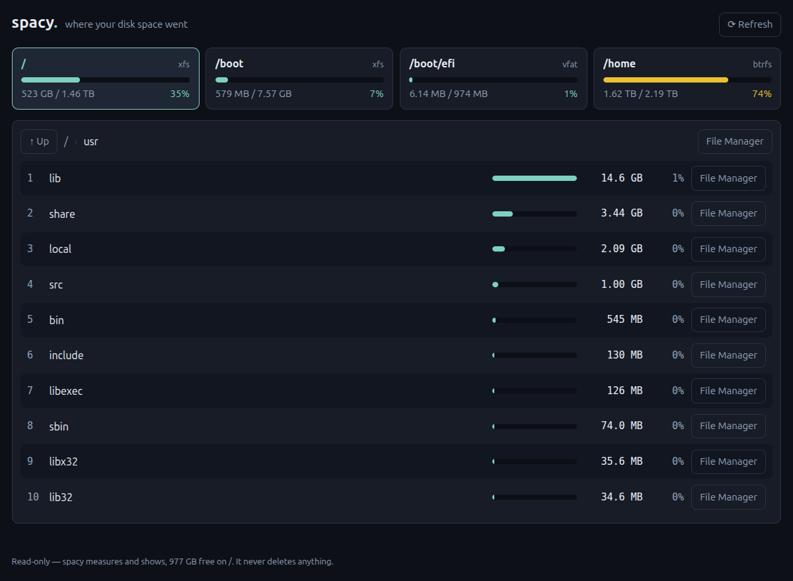

<h1 align="center">spacy</h1>
<p align="center">
  <b>Where your disk space went.</b><br>
  Pick a partition → the 10 biggest folders → click to drill in → open it in your file manager.
</p>
<p align="center">
  <code>v0.1.1</code> · Linux · macOS · Windows · built on <a href="https://github.com/riagentic/aio">aio</a> · <a href="LICENSE">MIT</a>
</p>



## 🎯 Good for

- 💥 **"Disk full"** — find the missing 20 GB in three clicks instead of
  guessing
- 🧹 Old kernels in `/boot`, stale caches, forgotten `node_modules`, VM images,
  downloads
- 🧭 Deciding **what** to delete — then deleting it yourself, in your own file
  manager
- 👀 Only lists partitions you can actually free space on: kernel/pseudo mounts,
  snap & AppImage bundles, ISO images and encrypted overlays are hidden
- 🔒 **Read-only by construction.** It only measures (`df`/`du`, or the OS
  equivalent) and opens your file manager — a test fails the build if any source
  file could delete, move or write

## 🚀 Run it

```sh
curl -fsSL https://raw.githubusercontent.com/riagentic/aio/main/run.sh | sh -s riagentic/spacy
```

One line — installs what's missing, clones, builds, opens the window.

Or clone it yourself:

```sh
curl -fsSL https://raw.githubusercontent.com/riagentic/aio/main/install.sh | sh   # once: Deno + am
git clone https://github.com/riagentic/spacy && cd spacy
am fix && deno task dev
```

Linux needs GNU `df`/`du` and `xdg-open` (any desktop); macOS and Windows need
nothing extra.

## 🛠 Develop

```sh
deno task test             # unit + cell + UI tests, against a real temp tree
deno task lint             # aio project linter
deno task compile          # → dist/spacy-<version>-x86_64.AppImage
```

`src/disk.ts` pure domain · `src/disk.server.ts` the only IO · `src/cell.ts`
state · `src/App.tsx` + `src/ui/` view. See [CLAUDE.md](CLAUDE.md).
